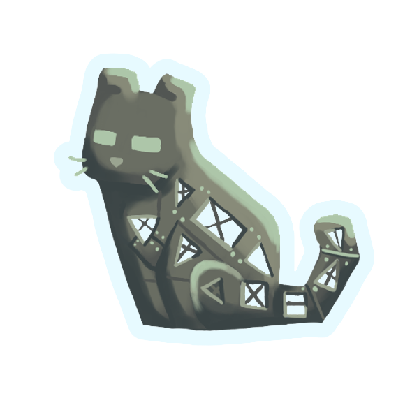

<div align="center">



# Copycats+ · Create Fly Port

**More shapes. Your materials. Fabric & NeoForge.**

An unofficial port of **Create: Copycats+ 3.0.7** for **Create Fly**.

[](#compatibility)
[](#upcoming-support)
[](#compatibility)
[](#compatibility)
[](https://github.com/Lucahthecreator/copycats--createfly-fabric-port/actions/workflows/compatibility.yml)

[**CurseForge**](https://www.curseforge.com/minecraft/mc-mods/createfly-copycats-port) ·
[**Modrinth**](https://modrinth.com/mod/copycats+-createfly-port) ·
[**Report a Bug**](https://github.com/Lucahthecreator/copycats--createfly-fabric-port/issues/new?template=bug_report.yml) ·
[**Suggest an Improvement**](https://github.com/Lucahthecreator/copycats--createfly-fabric-port/issues/new?template=enhancement.yml)

</div>

> [!NOTE]
> Maintained by **lucahTheCreator**, with permission from the original Copycats+ team.
> This is an unofficial port and is not maintained by the original developers.

## Build with the blocks you want

Use copied materials on boards, slabs, stairs, panes, layers, slopes, doors, shafts, cogwheels, and more.

Multi-material blocks let you customize individual parts, while functional blocks integrate with Create machines and contraptions.

- **Flexible shapes** — Build using partial blocks, detailed shapes, and larger pieces.
- **Copied materials** — Apply existing Minecraft block textures to copycat shapes.
- **Create integration** — Use functional copycats with machines and moving contraptions.
- **Connected textures** — Support compatible connected materials, including framed glass.

With ColorLight installed, this port unwraps its model hook to preserve connected textures. ColorLight-specific tinting or lighting may appear differently on copycat surfaces.

## What's new in v1.16

**Fixed the placement crash with Create Fly 26.2-6.0.9-2 beta.**

The renderer now supports both Create Fly's newer single-normal API and its older four-normal API.

Additional improvements:

- Shared renderer compiles directly from source.
- Normal adapter compatibility is checked against real Create Fly dependencies.
- Development launchers support both newer and older Create Fly versions.
- Improved compatibility checks during builds.

See the [changelog](CHANGELOG.md) for more information.

> [!IMPORTANT]
> This is the current source version. CurseForge and Modrinth may have an earlier published build.

## Compatibility

All supported Minecraft targets and the 1.21.11 beta backport are kept in this repository branch. Select a target from `Copycats Build and Test.bat` on Windows, or use the Gradle commands below.

| Minecraft target | Status | Java | Fabric Loader | Fabric API | Create Fly |
| :--- | :--- | :---: | :--- | :--- | :--- |
| **1.21.11** | Beta; gameplay testing | 21 | 0.19.2+ (development client uses 0.19.3) | 0.141.6 | 1.21.11-6.0.9-5 |
| **26.1–26.1.2** | Supported (v1.16) | 25 | 0.19.2+ | 0.152.1+26.1.2 | 6.0.9-4 tested |
| **26.2** | Supported (v1.16) | 25 | 0.19.2+ | 0.152.2+26.2 | 26.2-6.0.9-2 beta; 26.2-rc-2-6.0.9-1 compatibility build |
| **26.3** | Planned | 25 | — | — | — |

### Build outputs

The Windows build menu saves selected JARs in `dist/` with these names:

- `Copycats-CreateFly-1.21.11-beta.1.jar`
- `Copycats-CreateFly-26.1+-v1.16.jar` — target 26.1.2; supports the 26.1 release line.
- `Copycats-CreateFly-26.2-beta-v1.16.jar`
- `Copycats-CreateFly-26.2-compat-v1.16.jar` — compatibility build for the earlier Create Fly API.

The 1.21.11 beta is a gameplay-testing build. It is built from this repository and is not yet listed as a released download on CurseForge or Modrinth.

> [!WARNING]
> **NeoForge builds are not officially available yet.**
>
> Fabric and NeoForge require separate builds. Do not attempt to load a Fabric JAR using NeoForge.

## Upcoming support

Work is planned to expand support across both Fabric and NeoForge.

| Version | Planned development |
| :--- | :--- |
| **26.3 Fabric** | New Minecraft version support |
| **26.3 NeoForge** | NeoForge adaptation |
| **26.2 NeoForge** | NeoForge adaptation |
| **26.1 NeoForge** | NeoForge adaptation |

Release dates have not been confirmed. Support depends on compatible Create Fly builds, successful compilation, and gameplay testing.

### Community NeoForge development

The **Zoompack 5 team** has developed a community adaptation for Minecraft 26.3 using NeoForge.

Their work includes:

- A NeoForge 26.3 port based on this project's source.
- Compatibility work for Create Fly on NeoForge.
- Build and static compatibility checks.
- Dedicated server and client startup testing.

**Community resources:**

- [NeoForge 26.3 source branch](https://github.com/zoom-packers/copycats-createfly/tree/zp5/26.3)
- [Porting documentation](https://github.com/zoom-packers/copycats-createfly/blob/zp5/26.3/neoforge-26.3/PORTING.md)

This is a separate community adaptation and is not an official release maintained by lucahTheCreator.

The Zoompack 5 team has been advised to request permission from the original Copycats+ developers before publicly redistributing their adaptation.

## Installation

1. Choose the Minecraft target you want to play.
2. Install the matching Java version, Fabric Loader, Fabric API, and Create Fly from the compatibility table. Minecraft 1.21.11 uses Java 21; Minecraft 26.x uses Java 25.
3. Download the matching released Copycats+ build from [CurseForge](https://www.curseforge.com/minecraft/mc-mods/createfly-copycats-port/files) or [Modrinth](https://modrinth.com/mod/copycats+-createfly-port/versions). For the 1.21.11 beta, build it from this branch with the Windows menu and use the JAR from `dist/`.
4. Place the JAR in that Minecraft instance's `mods` folder.
5. Remove older Copycats+ JARs from the same instance before updating.
6. Launch Minecraft and test in a creative world. For multiplayer, install matching required mods on both the client and server.

## Help and feedback

| Report type | Link |
| :--- | :--- |
| Bug or crash | [Report a bug](https://github.com/Lucahthecreator/copycats--createfly-fabric-port/issues/new?template=bug_report.yml) |
| Feature request | [Suggest an improvement](https://github.com/Lucahthecreator/copycats--createfly-fabric-port/issues/new?template=enhancement.yml) |
| Mod compatibility | [Report compatibility issue](https://github.com/Lucahthecreator/copycats--createfly-fabric-port/issues/new?template=compatibility.yml) |
| Installation help | [Ask a question](https://github.com/Lucahthecreator/copycats--createfly-fabric-port/issues/new?template=question.yml) |

Before reporting an issue, search [existing issues](https://github.com/Lucahthecreator/copycats--createfly-fabric-port/issues).

Include Minecraft version, loader version, Create Fly version, reproduction steps, and logs when possible.

## Development

A **Java 25 JDK** is required.

The [1.21.11 beta backport](backport-1.21.11/README.md) is included in this same branch. It targets Java 21 and Create Fly 1.21.11-6.0.9-5. Minecraft 26.x targets use Java 25.

```bash
# Build Minecraft 1.21.11 beta with Java 21
./gradlew -p backport-1.21.11 build

# Build Minecraft 26.1.2
./gradlew build -Ptarget_version=26.1.2

# Build Minecraft 26.2
./gradlew build -Ptarget_version=26.2

# Verify compatibility with the older Create Fly API
./gradlew verifyNormalsCompatibility -Ptarget_version=26.2 -Pcreate_fly_version=26.2-rc-2-6.0.9-1
```

On Windows, use `gradlew.bat` instead of `./gradlew`.

Compiled JAR files are located in `build/libs`.

### Windows build and test menu

Double-click **`Copycats Build and Test.bat`** to choose a build or launch a development test client. Build selections copy the completed JAR into `dist/`; the “build all” option creates all four listed variants. The menu selects Java 21 for 1.21.11 and Java 25 for 26.x. Install Eclipse Temurin JDK 21 and JDK 25, or set `JAVA_HOME` to the required JDK before using the menu.

The menu offers these builds:

- Minecraft 1.21.11 beta.
- Minecraft 26.1 release line, built with target 26.1.2.
- Minecraft 26.2 with Create Fly 6.0.9-2 beta.
- Minecraft 26.2 with Create Fly 6.0.9-1 for compatibility testing.

It also launches isolated development clients for 1.21.11, 26.1.2, and both 26.2/Create Fly combinations. Close an existing client for a target before launching it again. You can also build all versions from PowerShell with `scripts/build-supported.ps1`.

### Development clients

| Launcher | Minecraft / Create Fly |
| :--- | :--- |
| `Copycats Build and Test.bat` | Menu for all supported builds and test clients |
| `Test Copycats.cmd` | 26.2 / Create Fly 6.0.9-2 beta |
| `Test Copycats - Older Create Fly.cmd` | 26.2 / Create Fly 6.0.9-1 |
| `backport-1.21.11/run-test-client.bat` | 1.21.11 beta / Create Fly 6.0.9-5 |

The menu and launch scripts select a matching installed Eclipse Temurin JDK: Java 21 for 1.21.11 and Java 25 for 26.x. The 26.x script also uses `JAVA_HOME` when it points to Java 25.

For Minecraft 26.1.2:

```powershell
powershell -ExecutionPolicy Bypass -File scripts/run-dev-client.ps1 -Minecraft 26.1.2
```

In a development client, run `/copycats_test` in a world to place a gallery of
every public Copycats block near the player. A barrel beside the gallery holds
the item-only box and catwalk components, plus grass, stone, and glass for
material checks. The command looks for empty space and raises the gallery if
the nearby ground is occupied. It is unavailable in normal mod installations.

### Rendering diagnostics

After the first launch, edit:

`config/copycats-debug.properties`

Available options include:

- `enabled=true` — Enable all diagnostic categories.
- `limit` — Limit log output per category.
- `ct` — Connected textures.
- `door` — Door rendering.
- `material` — Copied material handling.
- `shape` — Shape rendering.
- `filter` — Rendering filters.
- `face_hiding` — Face visibility.

Search logs for `[Copycats Debug/` or `Create Fly normals compatibility:`.

### Source layout

- `patches/src/main/java` — Active compatibility patches.
- `reconstructed/src/main/java` — Reconstructed source files.
- `reconstructed/working.jar` — Remaining precompiled classes.

Not all reconstructed Java files are automatically compiled into releases. Changes to unselected files may not affect the final JAR.

## Credits and permission

| Project | Credits |
| :--- | :--- |
| **Original Copycats+** | Lysine, Bennyboy1695, Redcat_XVIII, and the Copycats+ team |
| **Create Fly** | ZurrTum and contributors |
| **Fabric port** | lucahTheCreator |
| **Future NeoForge port** | lucahTheCreator (planned) |
| **Community NeoForge adaptation** | Zoompack 5 team |

[Original Copycats+](https://github.com/copycats-plus/copycats) ·
[Create Fly](https://github.com/ZurrTum/Create-Fly) ·
[License](LICENSE)

<details>
<summary><strong>Permission to publish this unofficial port</strong></summary>

Bennyboy1695 granted permission on behalf of the Copycats+ team under these conditions:

- The source code must remain visible on GitHub.
- This port should be archived or deprecated when Copycats+ officially supports the corresponding version.


Original Copycats+ code, assets, and features belong to their respective developers.

Permission to use code contributed by lucahTheCreator does not automatically grant redistribution rights to the original Copycats+ code.

Additional public forks or adaptations should obtain the necessary permission from the original Copycats+ team.

</details>

---

<div align="center">

**Maintained by [lucahTheCreator](https://github.com/Lucahthecreator)**

*Unofficial Copycats+ port for Create Fly.*

**Fabric available now · NeoForge planned · More versions coming**

</div>
